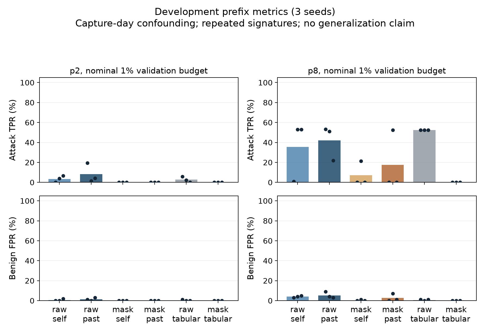

# GTAE-IDS Reassessment: Causal Capture-Order Audit and Field–Context Factorial Study

[](#)
[](https://www.python.org/)
[](https://pytorch.org/)
[](LICENSE)

This repository hosts the official implementation, replication pipelines, and empirical artifacts for the research paper:

> **When Does Graph Context Help Early Packet Anomaly Detection? A Causal Reassessment, Capture-Order Audit, and Field–Context Development Study of GTAE-IDS**  
> *Yalam Niranjan, Gaddam Hrishik Reddy, and Prudhivi Aditya*  
> Department of Computer Science and Engineering, Indian Institute of Information Technology, Design and Manufacturing (IIITDM), Kancheepuram.  
> Course Project: Computer and Network Security (CNS 2026–27).

---

## Overview

GTAE-IDS (*IEEE Transactions on Information Forensics and Security*, 2025) proposed an early packet-graph anomaly detection framework, reporting **99.04% attack detection** at packet $p=8$ with a **6.56% false positive rate** on CICIDS2017.

This repository implements a rigorous, causal re-examination of GTAE-IDS focusing on:
1. **Temporal Causality & Future Leakage**: Graph construction from static or whole-capture windows exposes future communications to early decision points ($t_{i,p}$). We enforce a strict causal observation contract where decisions only access context edges ordered strictly before $t_{i,p}$ by physical PCAP arrival record.
2. **Header Field Volatility**: Tracing the 25 retained IPv4/TCP header bytes reveals that volatile session identifiers (IP ID, checksums, absolute TCP sequence numbers) drive feature uniqueness. Masking these fields causes 5,561 unique raw $p=2$ vectors to collapse into only 307 keys.
3. **Factorial Experimentation**: A complete $2 \times 2 \times 2 \times 3$ factorial design crossing:
   - Header representation: Raw vs. Masked (14 zeroed session/checksum bytes)
   - Graph context: Self-only vs. Past-only ($\le 60$s lookback, $\le 128$ edges)
   - Prefix length: $p=2$ vs. $p=8$ packets
   - 3 random seeds (20261104, 20261105, 20261106)
   - Benchmarked against 12 tabular Isolation Forest controls without graph encoders.
4. **Empirical Findings**: Blanket header masking does not consistently repair detection (mean $p=8$ attack recall drops from 42.06% to 17.46% with wide seed swings), while a simple tabular Isolation Forest achieves 52.38% attack recall at only 0.67% benign false alarms.

---

## Directory Structure

```
.
├── README.md
├── requirements.txt
├── experiments/
│   ├── field_context.py          # PCAP arrival extraction, masking & causal graphs
│   ├── run_factorial.py          # 24-fit neural factorial & tabular IF controls
│   ├── summarize_factorial.py    # Metric aggregation and graph plotting
│   ├── test_field_context.py     # Unit test suite verifying causal invariants
│   ├── recover_calibration.py    # Validation threshold & calibration recovery
│   └── factorial-2026-11-04/     # Empirical outputs and results
│       ├── RESULTS.md            # Complete measured results and breakdown
│       ├── results.json          # Machine-readable metric exports (72 rows)
│       ├── manifest.json         # Frozen target IDs, stage counts, and hashes
│       ├── development-results.pdf # Result plots (Vector PDF)
│       └── development-results.png # Result plots (Raster PNG)
```

---

## Quickstart

### 1. Installation

```bash
git clone https://github.com/Niranjan7771/GTAE.git
cd GTAE
pip install -r requirements.txt
```

### 2. Run Invariant and Unit Tests

```bash
python -m unittest experiments/test_field_context.py
```
This tests:
- Byte offsets and position masks for the 25 retained header fields.
- Enforcement that past-only graphs contain no packet records occurring after $t_{i,p}$.
- Invariance of edge tokens and self-context isolation.

### 3. Reproduce Factorial Fitting and Evaluation

```bash
# Extract and build physical PCAP record arrivals
python experiments/field_context.py extract

# Prepare chronological group-disjoint splits and manifest
python experiments/run_factorial.py prepare

# Train 24 neural fits and 12 tabular baselines across 3 seeds
python experiments/run_factorial.py run

# Aggregate results and generate figures
python experiments/summarize_factorial.py
```

---

## Key Experimental Results

Means across 3 fixed random seeds at nominal 1% benign validation budget (evaluated on 210 attacks and 100 benign flows):

| Prefix ($p$) | Header Representation | Context Arm | Attack TPR (%) | Benign FPR (%) |
|:---:|:---|:---|:---:|:---:|
| 2 | Raw | Self | 3.49% | 0.67% |
| 2 | Raw | Past-only | 8.41% | 1.33% |
| 2 | Masked | Self | 0.00% | 0.00% |
| 2 | Masked | Past-only | 0.00% | 0.00% |
| 2 | Raw | Tabular IF (Control) | 2.70% | 0.33% |
| **8** | **Raw** | **Past-only** | **42.06%** | **5.33%** |
| **8** | **Masked** | **Past-only** | **17.46%** | **2.67%** |
| **8** | **Raw** | **Tabular IF (Control)** | **52.38%** | **0.67%** |



---

## Authors & Citation

- **Yalam Niranjan** (CS23B1076, cs23b1076@iiitdm.ac.in)
- **Gaddam Hrishik Reddy** (CS23B1083, cs23b1083@iiitdm.ac.in)
- **Prudhivi Aditya** (CS23B1087, cs23b1087@iiitdm.ac.in)

*Department of Computer Science and Engineering, Indian Institute of Information Technology, Design and Manufacturing (IIITDM), Kancheepuram, Chennai, India.*
